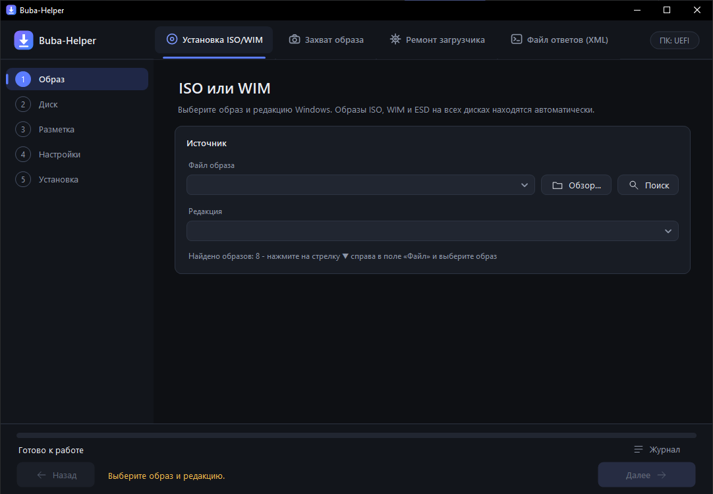
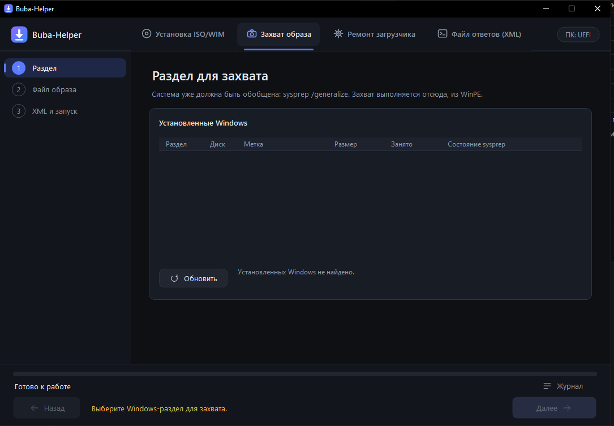
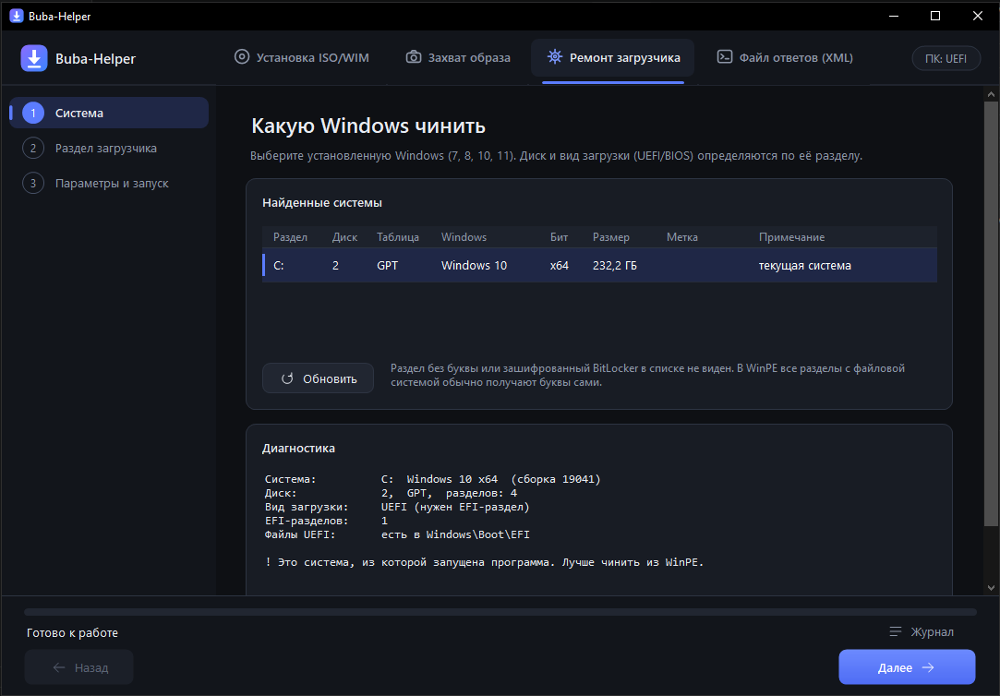
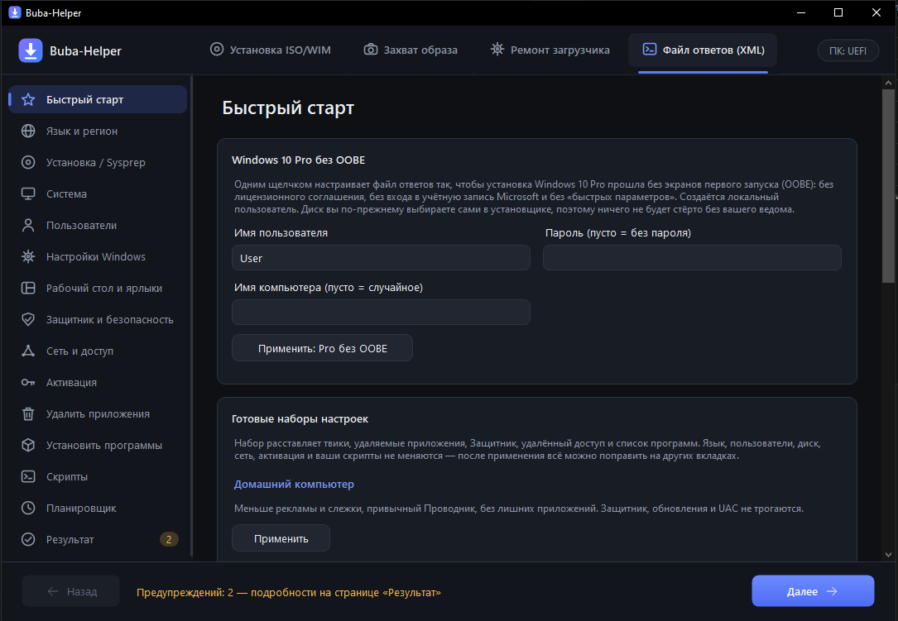

# Buba-Helper

[](https://github.com/barnibeats/Buba-Helper/actions/workflows/build.yml)
[](LICENSE)


Графическая утилита для **WinPE** (Sergei Strelec и др.) и обычной Windows. Четыре режима: **установка ISO/WIM/ESD** с выбором диска, разметки GPT/MBR, размера (МБ или ГБ) и раздела восстановления; **захват** sysprep-образа в WIM; **ремонт загрузчика** Windows 7/8/10/11 (UEFI и BIOS) и **генератор файла ответов** (utounattend.xml / unattend.xml), встроенный в программу. Генератор — порт [generator_XML_Windows](https://github.com/barnibeats/generator_XML_Windows) на C#.
Один `exe`, без установки и зависимостей, кроме .NET Framework 4.

> **In short:** a single-file WinForms tool for WinPE. *Install*: pick image (ISO/WIM/ESD) → pick disk (the WinPE boot media is excluded) → partition (GPT/MBR, size in MB or GB, optional recovery partition) → apply (DISM) → boot files (bcdboot UEFI/BIOS); can reinstall only the Windows partition, supports unattend XML, driver injection, SHA-256 verification, reusable profiles and a fully automatic mode. *Boot repair* for Windows 7-11: rebuild the BCD, write the EFI/BIOS boot files, create or move the EFI partition (even in front of Windows, via a WIM copy). *Capture* a sysprepped Windows partition into a `.wim`. UI is in Russian.

| Установка ISO/WIM | Захват образа |
|---|---|
|  |  |
| **Ремонт загрузчика** | **Файл ответов (XML)** |
|  |  |

## Возможности

**Установка ISO/WIM**
- Образы **ISO / WIM / ESD**: автопоиск на всех дисках, ISO монтируется сам (`virtdisk.dll`, без PowerShell), запасной путь — распаковка `install.wim` через `7z.exe`.
- Список редакций читается прямо из заголовка WIM (запасной вариант — `dism /Get-WimInfo`).
- Диски определяются через Win32 API (модель, размер, шина, стиль, тома) — **без разбора локализованного вывода** `diskpart`. USB-диски подсвечены, от выбора защищены диск с образом и **загрузочный носитель** (диск, с которого запущена программа или загружена WinPE, установочная флешка с `sources\boot.wim`, в обычной Windows — диск текущей системы).
- Два режима:
  - **Стереть весь диск**: GPT (EFI 300 МБ + MSR 16 МБ + Windows) или MBR (один активный раздел); размер Windows вводится **в МБ или ГБ** (переключатель рядом с полем; `51200` МБ = 50 ГБ) или «весь диск»; по желанию — **раздел восстановления** (Windows RE, 1024 МБ: `Winre.wim` из образа копируется в него и регистрируется через `reagentc`; для GPT — тип и атрибуты по рекомендации Microsoft, для MBR — тип `27`); остаток — раздел *Data*.
  - **Только раздел Windows**: форматируется один раздел, остальное (Data и т. д.) не трогается; загрузчик — в существующий EFI-раздел (GPT) или активный раздел (MBR).
- Режим ПК (UEFI/BIOS) определяется сам; при несовпадении с разметкой — предупреждение.
- `dism /Apply-Image` → драйверы из папки (`/Add-Driver /Recurse`) → **unattend XML** (необязательно) → `bcdboot` → проверка загрузочных файлов.
- **Проверка SHA-256**: если рядом с образом лежит `.sha256`, сумма сверяется *до любых изменений диска*.
- Перед перезагрузкой — диалог «Вытащите флешку» с отсчётом 15 с, звуковой сигнал по итогу.

**Профили и авторежим**
- Настройки сохраняются в `.ini` (см. [`docs/profile.example.ini`](docs/profile.example.ini)); `profile.ini` рядом с exe подхватывается сам.
- `Buba-Helper.exe --profile office.ini --auto` — сама находит образ по имени, выбирает единственный внутренний диск и запускает установку.

**Захват образа (sysprep)**
- Офлайн-проверка, что система обобщена (`GeneralizationState = 7`).
- `dism /Capture-Image /CheckIntegrity`, необязательный XML ответов (на время захвата кладётся в `Windows\Panther\Unattend`, потом раздел возвращается как был), проверка заголовка и запись `.sha256`.

**Ремонт загрузчика (Windows 7 / 8 / 10 / 11)** — подробно в [`docs/boot-repair.md`](docs/boot-repair.md)
- Список установленных Windows (версия по сборке `ntoskrnl.exe`, разрядность, диск, GPT/MBR) и диагностика: есть ли EFI-раздел или активный раздел, есть ли загрузочные файлы в самой Windows, совпадает ли режим ПК (UEFI/BIOS) с разметкой диска.
- Раздел для загрузчика выбирается из таблицы разделов диска (EFI для GPT, активный для MBR); раздел без буквы получает временную букву. Данные на разделах не стираются.
- `bcdboot` (UEFI/BIOS): BCD создаётся заново (старый сохраняется как `BCD.bak_…` или удаляется без копии — на выбор) или запись добавляется в существующий BCD (мультизагрузка). Для UEFI — запасной `EFI\Boot\bootx64.efi`; для BIOS — флаг «активный», `bootsect /nt60` и (по желанию) код загрузки в MBR. Если EFI-раздела нет (или он стоит неудобно), его можно создать заново (300 МБ): место берётся из неразмеченного участка диска или из выбранного раздела NTFS (уменьшается). EFI встаёт в начало диска, если там есть свободное место; существующие разделы программа не сдвигает, поэтому иначе он ставится в конец свободного участка, чтобы не мешать расширять соседний раздел. При пересоздании старый EFI-раздел удаляется вместе с загрузчиками других систем на нём.
- **Порядок «EFI → Windows → остальное».** Если перед Windows нет свободного места, можно выбрать перенос системы: Windows сохраняется в WIM-копию (на другой том или во временный раздел), разделы пересоздаются (EFI 300 МБ, затем Windows того же размера, остальное не трогается), копия разворачивается обратно. Только из WinPE; копия снимается и проверяется до удаления, перед удалением — ещё одно подтверждение. Точки восстановления («System Volume Information») не переносятся.
- Windows 7: x86-версии и версии без SP1 по UEFI загрузиться не могут (нет `Windows\Boot\EFI\bootmgfw.efi`) — программа предупредит. `bootsect.exe` берётся из папки `tools`, WinPE или PATH; если его там нет, используется вшитая в exe копия (x64, Windows 10 19041; извлекается в `%TEMP%\Buba-Helper`). В 32-разрядной WinPE вшитая копия не работает — положите x86-версию в `tools`. Чтобы вшить его самим, положите `assets\bootsect.exe` (из Windows 10/ADK, x64) перед сборкой: в репозиторий этот файл Microsoft не входит (`.gitignore`), а `build.cmd` без него собирается без вшитой копии.

**XML в ISO/WIM** — вшить файлы ответов в образ
- Источник — **ISO или WIM**. Для каждого из двух файлов ответов выбирается место: **корень ISO** (как `Autounattend.xml`, его читает установщик), **внутрь WIM** (`Windows\Panther\Unattend\Unattend.xml` и `Windows\Panther\unattend.xml`, во все редакции или только в выбранные) или то и другое. Для WIM-источника доступно только «внутрь WIM».
- ISO распаковывается в рабочую папку, WIM подключается через `dism /Mount-Image` и сохраняется `/Commit`; при сбое образ размонтируется с `/Discard`, рабочая папка удаляется. Новый ISO собирается `oscdimg` (BIOS + UEFI, метка тома сохраняется, по умолчанию UEFI без запроса «нажмите любую клавишу»); исходный образ не изменяется. Можно не собирать ISO, а оставить готовую папку.
- `oscdimg.exe` берётся из `tools`, WinPE, PATH или установленного Windows ADK (компонент Deployment Tools); без него ISO собрать нельзя, но WIM изменить можно.
- **Start-Sysprep.cmd** (необязательно) кладётся внутрь WIM в `Windows\System32\Sysprep`; файл ответов для Sysprep (без этапа windowsPE), идущий внутрь WIM, копируется туда же как `unattend.xml` — его читает `Start-Sysprep.cmd`.
- Кнопка «Вшить в ISO / WIM» в генераторе подставляет готовый XML сюда (для режима Sysprep — вместе с `Start-Sysprep.cmd`).

**Файл ответов (XML)** — встроенный генератор
- Чистая установка (`autounattend.xml`) и образ Sysprep (`unattend.xml`), Windows 10 и 11. 14 страниц: язык, установка и диск, система, пользователи, 75 твиков с поиском, рабочий стол и ярлыки, Защитник и брандмауэр, сеть и доступ, активация, удаление приложений, программы, скрипты, планировщик; страница «Результат» — предупреждения (щелчок ведёт к нужному полю), предпросмотр, сохранение XML и комплекта файлов.
- Быстрый старт **«Windows 10 Pro без OOBE»**: Pro по универсальному ключу, ручная разметка (диск не стирается), пропуск всех экранов OOBE, локальный пользователь. Плюс пресеты оригинала (дом, офис, приватность, разработчик, киоск).
- Кнопки «Использовать для установки» / «Для захвата образа» подставляют готовый XML в нужное поле. Настройки совместимы с JSON оригинального генератора (внимание: пароли в них лежат открытым текстом).
- **Для готовых образов** (WIM, `dism /Apply-Image`, sysprep): обои из файла с запретом смены, правила брандмауэра для программ, папок и портов, переименование ярлыков и копирование их на рабочий стол, задачи планировщика в своей папке (`\IT\имя`) с перезапуском при сбое, запрет смены темы, скрытие «Провести собрание», поля поиска и папок профиля в «Этом компьютере», значки рабочего стола только у встроенного Администратора, закрытый Центр обновления для всех, кроме Администратора. Настройки по пользователям выполняются через Active Setup без мигающих окон. Подробности и подводные камни — [`docs/image-deploy-notes.md`](docs/image-deploy-notes.md).
- Скрипты из файла ответов извлекаются и при `sysprep /unattend:`, и когда XML просто лежит в `Panther\Unattend\Unattend.xml` (образ, развёрнутый через DISM).
- Результат совпадает с оригиналом **посимвольно**, пока новые возможности выключены: `devtools/gen-compare.js` сверяет XML, предупреждения и `Start-Sysprep.cmd` на сотнях случайных состояний (два намеренных отличия описаны в начале скрипта). `devtools/check-gen.ps1` проверяет XML и синтаксис всех вшитых скриптов без установки Windows. Интерфейс проверяет встроенный «обезьяний» тест (`--selftest-ui`).
## Быстрый старт

1. Скачайте `Buba-Helper.exe` из [Releases](../../releases) (рядом лежит `.sha256`) или соберите сами (ниже).
2. Положите на флешку вместе с образами. Необязательно: папка `Drivers\`, `tools\7z.exe`, `profile.ini`.
3. В WinPE запустите `Buba-Helper.exe`, выберите образ → диск → разметку → **УСТАНОВИТЬ WINDOWS**.

Проверить сценарий, ничего не выполняя: `Buba-Helper.exe --dry-run` (команды `diskpart`/`dism`/`bcdboot` только пишутся в лог).

## Сборка

Нужен только `csc.exe` из .NET Framework 4 (есть в любой Windows 10/11):

```bat
build.cmd
```

Результат — `bin\Buba-Helper.exe`. Исходники лежат в [`src/`](src) (C# 5); генератор XML — в [`src/Gen/`](src/Gen) (данные берутся из `gendata.json`, вшитого в exe; обновить его из оригинала: `node devtools/export-gen-data.js <путь к generator_XML_Windows>`); оформление — `Theme.cs`. `Program.cs`, `IsoIntegrator.cs`, `Models.cs`, `Util.cs`, `Native.cs`, `IsoMount.cs`, `WimReader.cs` и главная форма `MainForm*.cs`, разбитая на части (`partial class`): интерфейс и мастер, диски, источник, разметка, профили, захват, установка, ремонт загрузчика (`MainForm.Repair.cs`), вшивание XML в ISO/WIM (`MainForm.Integrate.cs`). `build.cmd` собирает все `src\*.cs`. Версия программы — в `src\AssemblyInfo.cs`. Необязательно: `assets\bootsect.exe` (файл Microsoft, в репозиторий не входит) вшивается в exe, если лежит рядом при сборке.

## Версии и выпуск

Журнал изменений — [`CHANGELOG.md`](CHANGELOG.md) (формат Keep a Changelog, версии SemVer). Выпуск новой версии:

1. поднять версию в `src\AssemblyInfo.cs` и перенести записи из «Не выпущено» в раздел новой версии в `CHANGELOG.md`;
2. закоммитить, `git tag -a vX.Y.Z -m "..."`, `git push origin main vX.Y.Z`;
3. GitHub Actions соберёт `Buba-Helper.exe`, проверит генератор XML и опубликует релиз с `.sha256` (в нём нет вшитого `bootsect.exe`; свою сборку с ним делайте локально).

## Командная строка

| Ключ | Действие |
|---|---|
| `--dry-run` | ничего не выполнять, только лог |
| `--profile <файл.ini>` | загрузить профиль |
| `--auto` | (с `--profile`) выбрать диск по правилу и перейти к установке с обычным подтверждением |
| `--export-icon <файл.ico>` | записать значок приложения (нужен только для пересборки `assets\app.ico`) |
| `--gen <настройки.json> <out.xml>` | сгенерировать файл ответов без окна (`--preset <id>`, `--launcher <файл.cmd>`); рядом пишется `out.xml.log` с предупреждениями |
| `--integrate <iso или wim> <результат> [--root xml] [--wim xml] [--both xml] [--index 3,4] [--label L] [--work папка] [--folder] [--prompt]` | вшить файлы ответов без окна: `--root` — в корень ISO, `--wim` — внутрь WIM, `--both` — туда и туда; журнал пишется в `<результат>.log`, код выхода 0/1 |
| `--mode install/capture/repair/integrate/xml`, `--page N` | открыть окно сразу в нужном режиме и на нужной странице |
| `--selftest-ui <отчёт.txt> [N] [seed]` | самопроверка интерфейса генератора |
| `--yes` | пропустить подтверждение. **Опасно:** диск стирается без вопроса. Только вместе с `--auto` |

`disk=auto` в профиле — единственный внутренний (не USB) диск; в режиме `keep` — единственный диск с установленной Windows. Если однозначно выбрать нельзя, ничего не запускается.

## Как это работает

```
[SHA-256] → diskpart (clean/convert/create/format  или  format одного раздела)
          → dism /Apply-Image → [dism /Add-Driver] → [unattend.xml]
          → bcdboot (/f UEFI  или  /f BIOS) → проверка bootmgfw.efi / bootmgr
```
Подробнее о захвате и sysprep — в [`docs/sysprep-workflow.md`](docs/sysprep-workflow.md).

## Безопасность и ограничения

- Режим «стереть весь диск» **необратимо уничтожает** данные на выбранном диске. Перед запуском всегда показывается диалог с моделью, размером и томами диска.
- Протестируйте сценарий на виртуальной машине, прежде чем применять на реальных ПК.
- Нужен .NET Framework 4 в WinPE (проверьте наличие `X:\Windows\Microsoft.NET`).
- Не поддерживаются разбитые образы (`install.swm`).
- Утилита поставляется «как есть» (см. [LICENSE](LICENSE)).

## Лицензия

[MIT](LICENSE)
