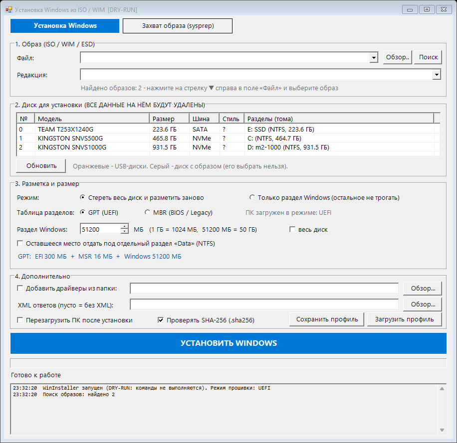
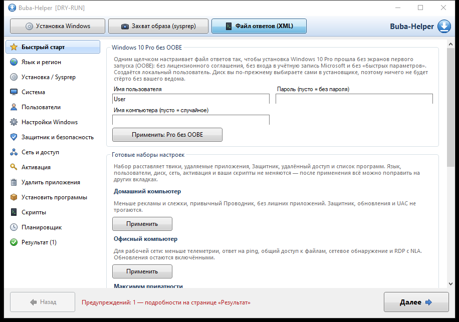
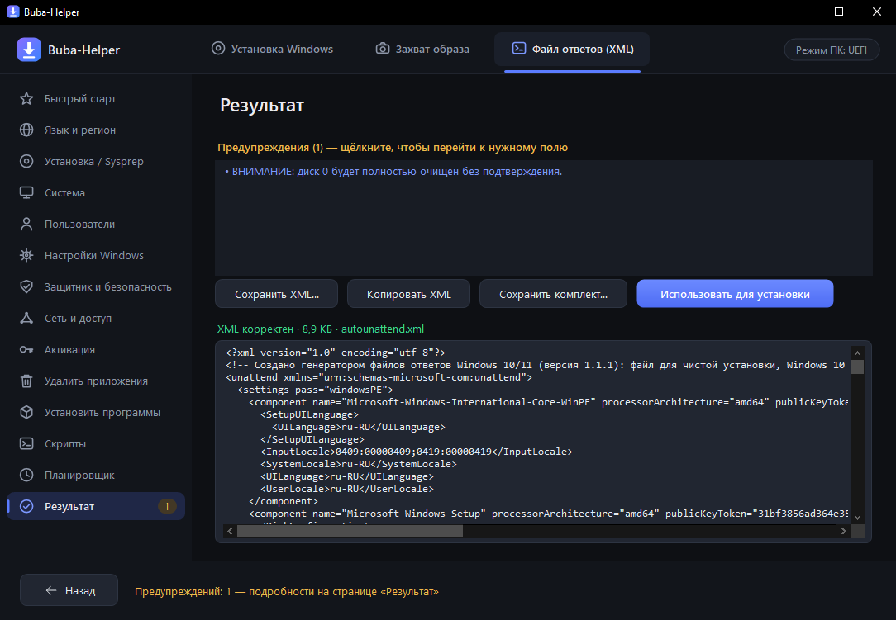
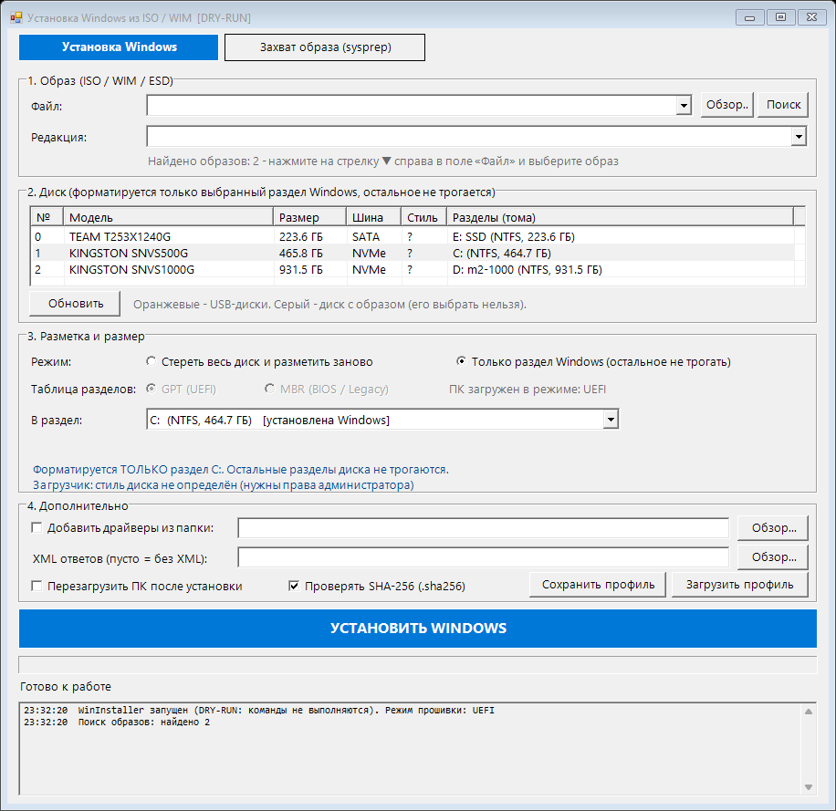
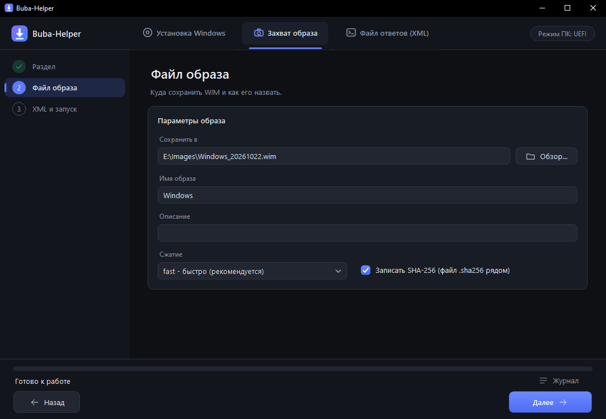
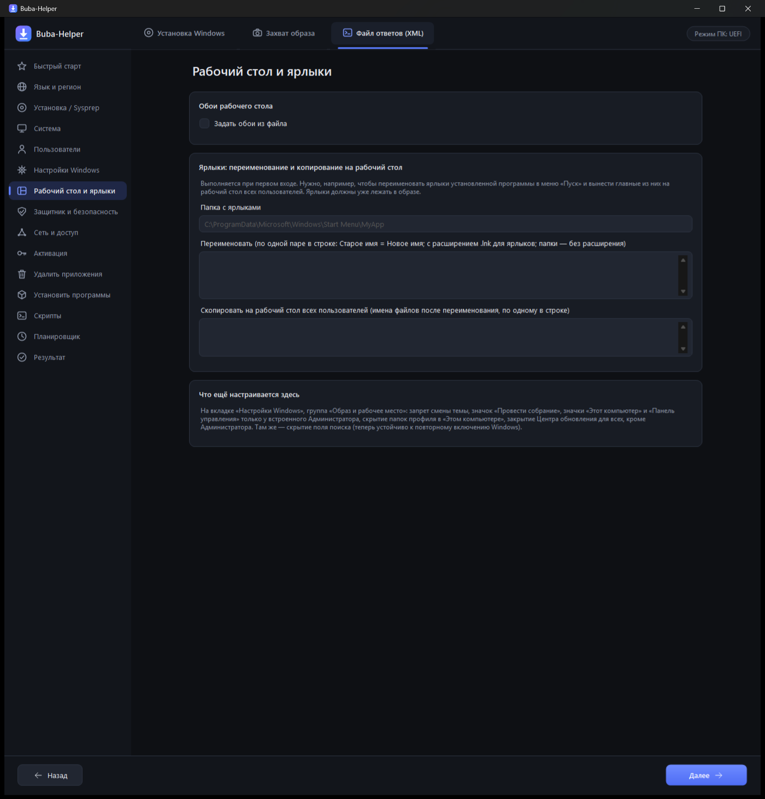

# Buba-Helper

[](https://github.com/barnibeats/win-install-helper/actions/workflows/build.yml)
[](LICENSE)


Графическая утилита для **WinPE** (Sergei Strelec и др.) и обычной Windows. Три режима: **установка** Windows из ISO/WIM/ESD с выбором диска и разметки GPT/MBR, **захват** sysprep-образа в WIM и **генератор файла ответов** (utounattend.xml / unattend.xml), встроенный в программу. Генератор — порт [generator_XML_Windows](https://github.com/barnibeats/generator_XML_Windows) на C#.
Один `exe`, без установки и зависимостей, кроме .NET Framework 4.

> **In short:** a single-file WinForms tool for WinPE that automates *pick image → pick disk → partition (GPT/MBR, size in MB) → apply (DISM) → boot files (bcdboot UEFI/BIOS)*, can reinstall only the Windows partition and keep the rest, supports unattend XML, driver injection, SHA-256 verification, reusable profiles and a fully automatic mode. It can also capture a sysprepped Windows partition into a `.wim`. UI is in Russian.



## Возможности

**Установка**
- Образы **ISO / WIM / ESD**: автопоиск на всех дисках, ISO монтируется сам (`virtdisk.dll`, без PowerShell), запасной путь — распаковка `install.wim` через `7z.exe`.
- Список редакций читается прямо из заголовка WIM (запасной вариант — `dism /Get-WimInfo`).
- Диски определяются через Win32 API (модель, размер, шина, стиль, тома) — **без разбора локализованного вывода** `diskpart`. USB-диски подсвечены, диск с образом защищён от выбора.
- Два режима:
  - **Стереть весь диск**: GPT (EFI 300 МБ + MSR 16 МБ + Windows) или MBR (один активный раздел); размер Windows вводится **в МБ** (`51200` = 50 ГБ) или «весь диск»; остаток — раздел *Data*.
  - **Только раздел Windows**: форматируется один раздел, остальное (Data и т. д.) не трогается; загрузчик — в существующий EFI-раздел (GPT) или активный раздел (MBR).
- Режим ПК (UEFI/BIOS) определяется сам; при несовпадении с разметкой — предупреждение.
- `dism /Apply-Image` → драйверы из папки (`/Add-Driver /Recurse`) → **unattend XML** (необязательно) → `bcdboot` → проверка загрузочных файлов.
- **Проверка SHA-256**: если рядом с образом лежит `.sha256`, сумма сверяется *до любых изменений диска*.
- Перед перезагрузкой — диалог «Вытащите флешку» с отсчётом 15 с, звуковой сигнал по итогу.

**Профили и авторежим**
- Настройки сохраняются в `.ini` (см. [`docs/profile.example.ini`](docs/profile.example.ini)); `profile.ini` рядом с exe подхватывается сам.
- `Buba-Helper.exe --profile office.ini --auto` — сама находит образ по имени, выбирает единственный внутренний диск и запускает установку.

**Захват образа (sysprep)**
- Офлайн-проверка, что система обобщена (`GeneralizationState = 7`).
- `dism /Capture-Image /CheckIntegrity`, необязательный XML ответов (на время захвата кладётся в `Windows\Panther\Unattend`, потом раздел возвращается как был), проверка заголовка и запись `.sha256`.

**Файл ответов (XML)** — встроенный генератор
- Чистая установка (`autounattend.xml`) и образ Sysprep (`unattend.xml`), Windows 10 и 11. 14 страниц: язык, установка и диск, система, пользователи, 75 твиков с поиском, рабочий стол и ярлыки, Защитник и брандмауэр, сеть и доступ, активация, удаление приложений, программы, скрипты, планировщик; страница «Результат» — предупреждения (щелчок ведёт к нужному полю), предпросмотр, сохранение XML и комплекта файлов.
- Быстрый старт **«Windows 10 Pro без OOBE»**: Pro по универсальному ключу, ручная разметка (диск не стирается), пропуск всех экранов OOBE, локальный пользователь. Плюс пресеты оригинала (дом, офис, приватность, разработчик, киоск).
- Кнопки «Использовать для установки» / «Для захвата образа» подставляют готовый XML в нужное поле. Настройки совместимы с JSON оригинального генератора (внимание: пароли в них лежат открытым текстом).
- **Для готовых образов** (WIM, `dism /Apply-Image`, sysprep): обои из файла с запретом смены, правила брандмауэра для программ, папок и портов, переименование ярлыков и копирование их на рабочий стол, задачи планировщика в своей папке (`\IT\имя`) с перезапуском при сбое, запрет смены темы, скрытие «Провести собрание», поля поиска и папок профиля в «Этом компьютере», значки рабочего стола только у встроенного Администратора, закрытый Центр обновления для всех, кроме Администратора. Настройки по пользователям выполняются через Active Setup без мигающих окон. Подробности и подводные камни — [`docs/image-deploy-notes.md`](docs/image-deploy-notes.md).
- Скрипты из файла ответов извлекаются и при `sysprep /unattend:`, и когда XML просто лежит в `Panther\Unattend\Unattend.xml` (образ, развёрнутый через DISM).
- Результат совпадает с оригиналом **посимвольно**, пока новые возможности выключены: `devtools/gen-compare.js` сверяет XML, предупреждения и `Start-Sysprep.cmd` на сотнях случайных состояний (два намеренных отличия описаны в начале скрипта). `devtools/check-gen.ps1` проверяет XML и синтаксис всех вшитых скриптов без установки Windows. Интерфейс проверяет встроенный «обезьяний» тест (`--selftest-ui`).
| Генератор: быстрый старт | Генератор: результат |
|---|---|
|  |  |

| Режим «только раздел Windows» | Захват образа |
|---|---|
|  |  |

| Файл ответов: «Рабочий стол и ярлыки» |
|---|
|  |

## Быстрый старт

1. Скачайте `Buba-Helper.exe` из [Releases](../../releases) (рядом лежит `.sha256`) или соберите сами (ниже).
2. Положите на флешку вместе с образами. Необязательно: папка `Drivers\`, `tools\7z.exe`, `profile.ini`.
3. В WinPE запустите `Buba-Helper.exe`, выберите образ → диск → разметку → **УСТАНОВИТЬ WINDOWS**.

Проверить сценарий, ничего не выполняя: `Buba-Helper.exe --dry-run` (команды `diskpart`/`dism`/`bcdboot` только пишутся в лог).

## Сборка

Нужен только `csc.exe` из .NET Framework 4 (есть в любой Windows 10/11):

```bat
build.cmd
```

Результат — `bin\Buba-Helper.exe`. Исходники лежат в [`src/`](src) (C# 5); генератор XML — в [`src/Gen/`](src/Gen) (данные берутся из `gendata.json`, вшитого в exe; обновить его из оригинала: `node devtools/export-gen-data.js <путь к generator_XML_Windows>`); оформление — `Theme.cs`. `Program.cs`, `Models.cs`, `Util.cs`, `Native.cs`, `IsoMount.cs`, `WimReader.cs` и главная форма `MainForm*.cs`, разбитая на части (`partial class`): интерфейс и мастер, диски, источник, разметка, профили, захват, установка. `build.cmd` собирает все `src\*.cs`.

## Командная строка

| Ключ | Действие |
|---|---|
| `--dry-run` | ничего не выполнять, только лог |
| `--profile <файл.ini>` | загрузить профиль |
| `--auto` | (с `--profile`) выбрать диск по правилу и перейти к установке с обычным подтверждением |
| `--export-icon <файл.ico>` | записать значок приложения (нужен только для пересборки `assets\app.ico`) |
| `--gen <настройки.json> <out.xml>` | сгенерировать файл ответов без окна (`--preset <id>`, `--launcher <файл.cmd>`); рядом пишется `out.xml.log` с предупреждениями |
| `--mode install/capture/xml`, `--page N` | открыть окно сразу в нужном режиме и на нужной странице |
| `--selftest-ui <отчёт.txt> [N] [seed]` | самопроверка интерфейса генератора |
| `--yes` | пропустить подтверждение. **Опасно:** диск стирается без вопроса. Только вместе с `--auto` |

`disk=auto` в профиле — единственный внутренний (не USB) диск; в режиме `keep` — единственный диск с установленной Windows. Если однозначно выбрать нельзя, ничего не запускается.

## Как это работает

```
[SHA-256] → diskpart (clean/convert/create/format  или  format одного раздела)
          → dism /Apply-Image → [dism /Add-Driver] → [unattend.xml]
          → bcdboot (/f UEFI  или  /f BIOS) → проверка bootmgfw.efi / bootmgr
```

Подробнее о захвате и sysprep — в [`docs/sysprep-workflow.md`](docs/sysprep-workflow.md).

## Безопасность и ограничения

- Режим «стереть весь диск» **необратимо уничтожает** данные на выбранном диске. Перед запуском всегда показывается диалог с моделью, размером и томами диска.
- Протестируйте сценарий на виртуальной машине, прежде чем применять на реальных ПК.
- Нужен .NET Framework 4 в WinPE (проверьте наличие `X:\Windows\Microsoft.NET`).
- Не поддерживаются разбитые образы (`install.swm`).
- Утилита поставляется «как есть» (см. [LICENSE](LICENSE)).

## Лицензия

[MIT](LICENSE)
